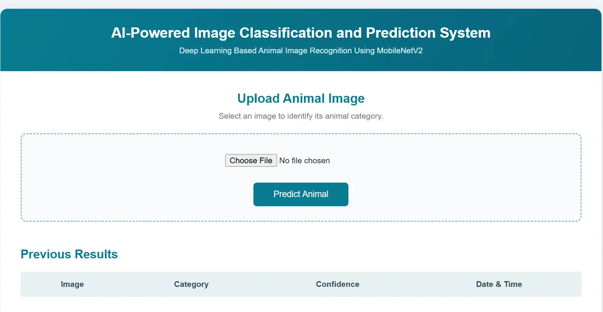
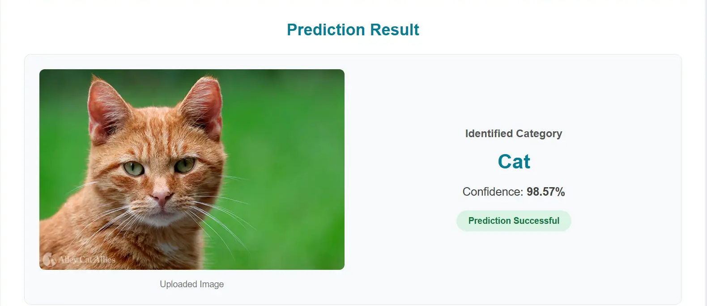
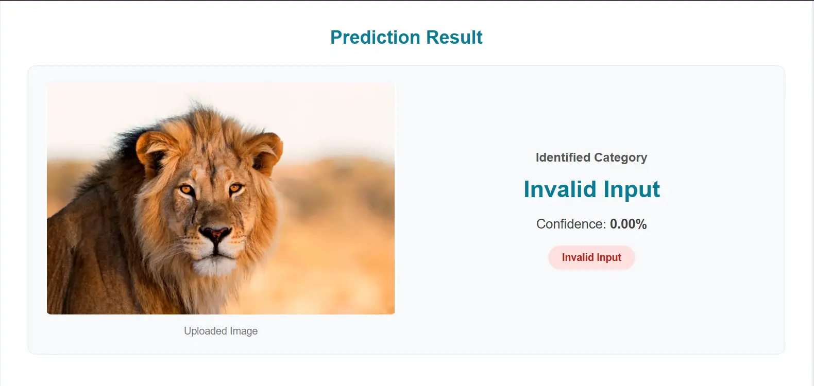

# AI-Powered Image Classification and Prediction System

A deep learning-based animal image classification application built using **PyTorch, MobileNetV2, and FastAPI**. The system identifies four animal categories — Cat, Dog, Horse, and Tiger — through an interactive web interface and REST API.

It also provides confidence-based prediction validation, dataset uploads, and model fine-tuning.

## Project Overview

This project combines a deep learning model with a FastAPI backend and a browser-based interface to provide an end-to-end image classification experience.

Users can upload an image, receive its predicted animal category, view prediction confidence, and access previous prediction results.

## Features

- **Four-Class Classification:** Identifies cats, dogs, horses, and tigers.
- **MobileNetV2 Architecture:** Uses a customized MobileNetV2 model implemented in PyTorch.
- **Web Interface:** Upload images and view predictions through a browser.
- **REST API:** Supports image prediction through FastAPI endpoints.
- **Confidence-Based Validation:** Rejects predictions with confidence below 70%.
- **Dataset Upload:** Supports individual labeled images and ZIP datasets.
- **Model Fine-Tuning:** Fine-tunes an existing trained model using uploaded training data.
- **Prediction History:** Displays recent unique prediction results in the web interface.
- **Automatic Dataset Splitting:** Creates training and validation datasets.
- **CPU/GPU Support:** Automatically selects CUDA when available, otherwise uses CPU.

## Application Screenshots

### 1. Main Application Interface



### 2. Successful Animal Prediction

The model successfully identifies a cat with 98.57% confidence in this example.



### 3. Invalid Input Detection

The system rejects predictions when confidence is below the configured threshold. This example demonstrates rejection of an unsupported animal category (lion).



## Technology Stack

| Component | Technology |
|---|---|
| Programming Language | Python |
| Deep Learning Framework | PyTorch |
| Model Architecture | MobileNetV2 |
| Computer Vision | Pillow, TorchVision |
| Backend Framework | FastAPI |
| ASGI Server | Uvicorn |
| Frontend | HTML, CSS, JavaScript |
| Template Engine | Jinja2 |
| API Testing | FastAPI Swagger UI |

## Model Details

| Parameter | Configuration |
|---|---|
| Architecture | MobileNetV2 |
| Number of Classes | 4 |
| Classes | Cat, Dog, Horse, Tiger |
| Input Image Size | 224 × 224 |
| Optimizer | Adam |
| Loss Function | CrossEntropyLoss |
| Learning Rate | 0.0001 |
| Batch Size | 16 |
| Training Epochs | 5 |
| Validation Split | 20% |
| Confidence Threshold | 70% |

### Prediction Workflow

1. Upload an image through the web interface or API.
2. Convert the image into RGB format.
3. Resize the image to 224 × 224 pixels.
4. Normalize the image using ImageNet normalization values.
5. Pass the image through the trained MobileNetV2 model.
6. Apply Softmax to obtain class probabilities.
7. Select the class with the highest probability.
8. Reject the prediction if its confidence is below 70%.
9. Return the predicted category and confidence.

## Project Structure

```text
Animal-Image-Classification/
│
├── app/
│   ├── __init__.py
│   ├── api.py
│   ├── config.py
│   ├── data_utils.py
│   ├── model_utils.py
│   └── templates/
│       └── index.html
│
├── scripts/
│   ├── download_dataset.py
│   ├── download_hf_animals.py
│   ├── download_tiger.py
│   └── train_model.py
│
├── data/                       # Generated application data (not committed)
│   ├── raw/
│   ├── train/
│   └── val/
│
├── dataset/                    # Optional dataset preparation storage
│
├── screenshots/
│   ├── 01-home-interface.png
│   ├── 02-successful-cat-prediction.png
│   └── 03-invalid-input-lion.png
│
├── class_names.txt
├── mobilenet_custom.pth
├── main.py
├── requirements.txt
├── run_project.ps1
├── .gitignore
└── README.md
```

## Installation and Setup

### Prerequisites

- Python 3.11
- Git
- VS Code (recommended)

### 1. Clone the Repository

```bash
git clone https://github.com/kavalignanesh/ai-powered-image-classification-and-prediction-system.git

cd ai-powered-image-classification-and-prediction-system
```

### 2. Create a Virtual Environment

Windows:

```powershell
python -m venv venv
```

Activate it:

```powershell
.\venv\Scripts\Activate.ps1
```

### 3. Install Dependencies

```bash
python -m pip install --upgrade pip
pip install -r requirements.txt
```

Note: PyTorch and TorchVision installation must use compatible builds for your system. The development environment uses CPU builds.

### 4. Run the Application

Using the included PowerShell launcher:

```powershell
.\run_project.ps1
```

Alternatively, start the server manually:

```bash
python -m uvicorn main:application --host 127.0.0.1 --port 8000
```

## Access the Application

Once the server starts, open:

| Resource | URL |
|---|---|
| Web Application | http://127.0.0.1:8000/web |
| API Welcome | http://127.0.0.1:8000/ |
| Swagger API Documentation | http://127.0.0.1:8000/docs |

## API Documentation

The application exposes the following endpoints:

| Method | Endpoint | Description |
|---|---|---|
| GET | `/` | API welcome message |
| GET | `/web` | Opens the web interface |
| POST | `/add_image` | Uploads labeled training images |
| POST | `/train` | Fine-tunes the model |
| POST | `/predict` | Predicts an uploaded image |
| POST | `/predict_form` | Predicts through an HTML form |

### Prediction API Example

Endpoint:

```text
POST /predict
```

Request:

- Content type: `multipart/form-data`
- Parameter: `image`
- Value: Image file

Example response:

```json
{
    "filename": "cat.jpg",
    "prediction": "cat",
    "confidence": "98.57%"
}
```

The confidence value depends on the uploaded image.

### Upload Labeled Images

Endpoint:

```text
POST /add_image
```

Parameters:

- `label`: Animal class name
- `images`: One or more image files

### Upload Dataset and Fine-Tune

Endpoint:

```text
POST /train
```

Accepts an optional ZIP dataset containing class folders.

Example ZIP structure:

```text
dataset.zip
├── cat/
├── dog/
├── horse/
└── tiger/
```

The application extracts the dataset, generates training and validation splits, and fine-tunes the existing model.

The trained model weights and class labels are saved locally.

## Dataset Preparation Scripts

The `scripts/` directory contains optional scripts for preparing animal image datasets and training a MobileNetV2 model.

| Script | Purpose |
|---|---|
| `download_dataset.py` | Collects animal images from Wikimedia Commons and records source and licence metadata. |
| `download_hf_animals.py` | Downloads cat, dog, and horse images from Hugging Face. |
| `download_tiger.py` | Downloads tiger images from a Hugging Face dataset. |
| `train_model.py` | Trains a MobileNetV2 model using a dataset stored in the project-root `dataset/` directory. |

These scripts are optional and are separate from the normal application startup process.

Run them from the project root using commands such as:

```powershell
python scripts/download_hf_animals.py
python scripts/download_tiger.py
python scripts/train_model.py
```

The Wikimedia dataset downloader can be run using:

```powershell
python scripts/download_dataset.py
```

**Important:** The downloader scripts use different source datasets and preparation workflows. Their outputs are not automatically converted into the application's `data/train` and `data/val` structure. The standalone training script also saves the model and labels in the project root. Review dataset licensing and attribution requirements before redistributing downloaded images.

## Dataset Information

The development dataset contains four animal categories:

- Cat
- Dog
- Horse
- Tiger

The working dataset contains approximately 500 images per category, giving 2,000 images in total.

The dataset is divided into training and validation subsets using an 80:20 split.

Dataset files are excluded from the Git repository to keep the repository lightweight.

## Important Notes and Limitations

- The model supports only four predefined animal categories.
- The 70% confidence threshold is a simple rejection mechanism, not a guaranteed out-of-distribution detector.
- Images from unsupported categories may be rejected or may receive an incorrect prediction with high confidence.
- Model accuracy depends on the quality and diversity of the training data.
- Application model fine-tuning requires the existing trained model weights.
- Training and prediction performance depends on available hardware.

## Future Improvements

- Improve generalization with more diverse training images.
- Implement robust out-of-distribution detection.
- Add model performance evaluation and confusion matrix visualization.
- Improve prediction explainability using Grad-CAM.
- Deploy the application to a cloud platform.
- Add automated testing and CI/CD integration.

## Author

**Gnanesh Kavali**

- GitHub: https://github.com/kavalignanesh
- LinkedIn: https://www.linkedin.com/in/gnaneshkavali/

---

If you find this project useful, consider giving the repository a star!
